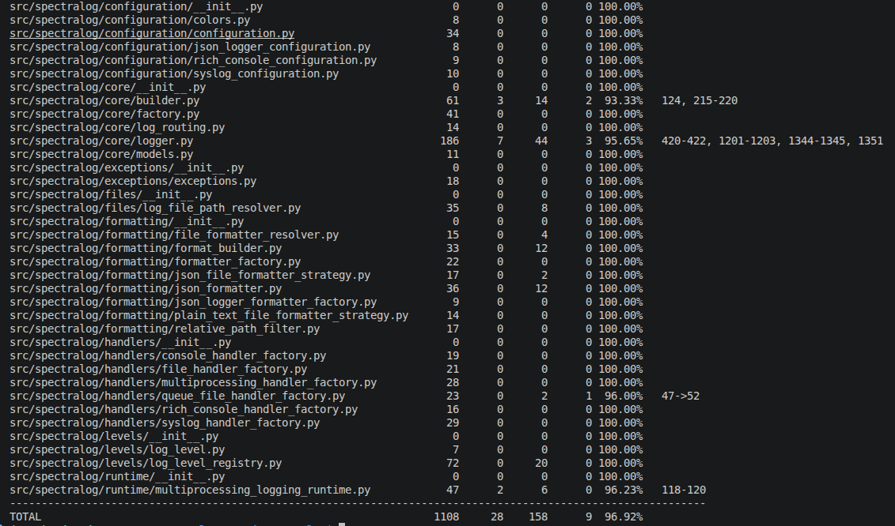
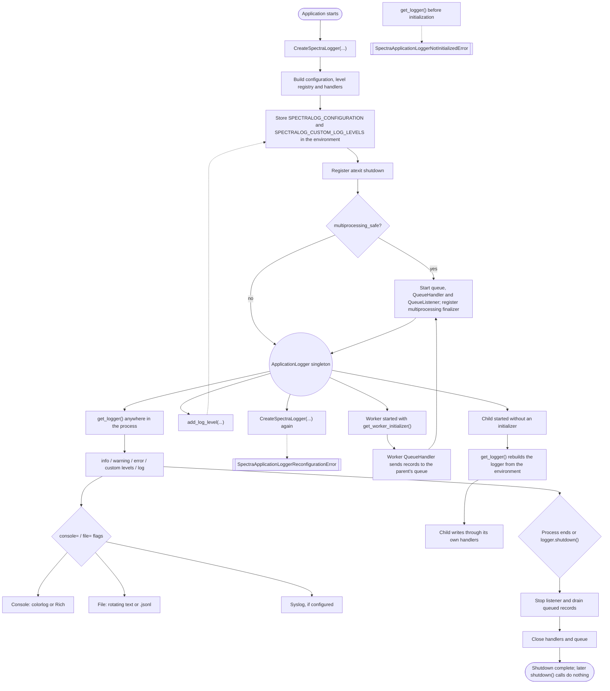

# SpectraLog

[](https://pypi.org/project/spectralog/)
[](https://github.com/AdnanEkici/spectralog/actions/workflows/ci.yml)
[](https://www.python.org/)
[](https://github.com/AdnanEkici/spectralog)
[](LICENSE)
[](https://adnanekici.github.io/spectralog/)


**SpectraLog** is a configurable Python logging package built on top of the standard-library `logging` module.

You configure it once when your application starts, then call `get_logger()` anywhere else in the process. Behind that small API it supports colored console output, rotating files, JSON Lines, Rich, syslog, custom log levels, per-record routing, and queue-based logging that is safe to use from worker processes.

```python
from spectralog import CreateSpectraLogger

logger = CreateSpectraLogger()

logger.info("Application started")
logger.warning("Something needs attention")
logger.error("Something went wrong")
```

```python
from spectralog import get_logger

logger = get_logger()
logger.info("Processing request")
```

**Links:** [Documentation](https://adnanekici.github.io/spectralog/) · [Source](https://github.com/AdnanEkici/spectralog) · [Issues](https://github.com/AdnanEkici/spectralog/issues)


## Table of Contents

- [Features](#features)
- [Installation](#installation)
- [Quick Start](#quick-start)
- [Public API](#public-api)
- [Logging Methods](#logging-methods)
- [Per-Record Routing](#per-record-routing)
- [File Logging](#file-logging)
- [Output Formats](#output-formats)
- [JSON Logging](#json-logging)
- [Rich Console Logging](#rich-console-logging)
- [Syslog Logging](#syslog-logging)
- [Custom Log Levels](#custom-log-levels)
- [Multiprocessing-Safe File Logging](#multiprocessing-safe-file-logging)
- [Silencing Logging](#silencing-logging)
- [Exceptions](#exceptions)
- [Configuration Reference](#configuration-reference)
- [Architecture](#architecture)
- [Thread Safety and Process Behavior](#thread-safety-and-process-behavior)
- [Shutdown](#shutdown)
- [Known Behavioral Boundaries](#known-behavioral-boundaries)
- [Development](#development)
- [Testing](#testing)
- [Documentation](#documentation)
- [Building and Releasing](#building-and-releasing)
- [Project Structure](#project-structure)
- [Contributing](#contributing)
- [License](#license)
- [Logger Lifecycle Diagram](#logger-lifecycle-diagram)


## Features

**Core**

- Python 3.10+ with a typed package (`py.typed`)
- Process-local application logger singleton with thread-safe initialization
- Standard `DEBUG`, `INFO`, `WARNING`, `ERROR` and `CRITICAL` levels
- Deferred `%`-style message formatting, exactly like standard `logging`
- Per-record console and file routing with `console=` and `file=`

**Destinations**

- Colored console output through `colorlog`
- Rotating file logging with configurable size, backup count, directory and file name
- Automatic daily log file names
- Structured JSON Lines (`.jsonl`) with configurable metadata, exception serialization and Unicode-safe output
- Rich console output with Rich tracebacks and optional markup
- Syslog over UDP or TCP with a configurable facility

**Formatting**

- Relative source paths and line numbers
- Custom console, file and date formats

**Levels**

- Custom log levels registered at runtime, each with its own color
- Custom levels exposed as methods, for example `logger.notice(...)`
- Custom levels carried over to child processes

**Processes and lifecycle**

- Queue-based multiprocessing-safe file logging
- Worker processes that send records to the parent's single listener, for both `fork` and `spawn`
- Children that can rebuild the logger from the parent's configuration
- Deterministic runtime shutdown through `atexit` and `multiprocessing` finalizers
- Explicit, idempotent `shutdown()`

**Testing**

- `@disable_application_logging` for `unittest.TestCase` classes, with per-test singleton isolation
- `@silence_application_logging` for ordinary functions and methods


## Installation

SpectraLog requires Python 3.10 or newer and is tested on 3.10, 3.11, 3.12 and 3.13. Its runtime dependencies are `colorlog` and `rich`.

From PyPI, once published:

```bash
python -m pip install spectralog
```

Directly from GitHub:

```bash
python -m pip install git+https://github.com/AdnanEkici/spectralog.git
```

From source, in editable mode:

```bash
git clone https://github.com/AdnanEkici/spectralog.git
cd spectralog
python -m pip install -e .
```

Optional extras:

```bash
python -m pip install -e ".[dev]"        # build, mypy, pre-commit, twine
python -m pip install -e ".[docs]"       # Sphinx and Furo
python -m pip install -e ".[dev,docs]"   # both
```

Applications that only use SpectraLog do not need the documentation tooling.


## Quick Start

Initialize SpectraLog once near your application's entry point:

```python
# application.py
from spectralog import CreateSpectraLogger

CreateSpectraLogger(
    debug_mode=True,
    log_file_name="application.log",
)
```

Retrieve the same logger anywhere else in the process:

```python
# service.py
from spectralog import get_logger

logger = get_logger()
logger.info("Service started")
```

With no arguments, SpectraLog:

- logs at `INFO` level;
- writes colored output to the console, with timestamps;
- writes a rotating log file under `logs/`, named after the current date (for example `logs/2026-10-12.log`);
- keeps JSON, Rich, syslog and multiprocessing-safe logging off.

The usage model in one line: **configure once, retrieve anywhere, log consistently.**


## Public API

Everything an application needs is importable from the package root:

```python
from spectralog import CreateSpectraLogger           # initialize the process logger
from spectralog import get_logger                    # retrieve it anywhere
from spectralog import get_worker_initializer        # attach worker processes to the parent's queue

from spectralog import JsonLoggerConfiguration       # optional JSON Lines output
from spectralog import RichConsoleConfiguration      # optional Rich console output
from spectralog import SyslogConfiguration           # optional syslog output

from spectralog import disable_application_logging   # silence a unittest.TestCase class
from spectralog import silence_application_logging   # silence a function or method
```

### Initialize Once

`CreateSpectraLogger(...)` builds the process-local `ApplicationLogger` singleton and returns it. `get_logger()` returns that same instance every time within the process.

Calling `get_logger()` before `CreateSpectraLogger(...)` raises `SpectraApplicationLoggerNotInitializedError`. The one exception is a child process started after the parent initialized SpectraLog; see [Children Without an Initializer](#children-without-an-initializer).

Calling `CreateSpectraLogger(...)` a second time in the same process raises `SpectraApplicationLoggerReconfigurationError`. A single owner of the configuration avoids competing file destinations, conflicting levels, duplicate handler sets, multiple multiprocessing runtimes and unclear shutdown ownership.


## Logging Methods

```python
logger.debug("Debug message")
logger.info("Informational message")
logger.warning("Warning message")
logger.error("Error message")
logger.critical("Critical message")
```

Use `exception` inside an active exception handler. The traceback is attached to the record:

```python
try:
    result = 10 / 0
except ZeroDivisionError:
    logger.exception("Calculation failed")
```

### Generic `log` Method

`logger.log(level, message, ...)` accepts a registered level name or an integer severity:

```python
logger.log("WARNING", "Disk usage is high")
logger.log(30, "Disk usage is high")
logger.log("NOTICE", "Deployment completed")   # after registering NOTICE
```

### Deferred Message Formatting

Arguments are passed through to the standard logger, so formatting only happens when the record is actually emitted:

```python
logger.info("User %s authenticated", user_name)
logger.info("Processed %d records in %s", record_count, duration)
```

Standard keyword arguments such as `exc_info`, `extra` and `stacklevel` are forwarded too. When `stacklevel` is omitted, SpectraLog supplies one so that file names and line numbers point at your code rather than at SpectraLog.

### Debug Level

`debug_mode=False` (the default) logs at `INFO`. `debug_mode=True` logs at `DEBUG`:

```python
logger = CreateSpectraLogger(debug_mode=True)
logger.debug("Detailed diagnostic information")
```


## Per-Record Routing

Every logging method, including custom-level methods and `log`, accepts `console` and `file` flags. Both default to `True`. They let one record skip a destination without changing the logger's configuration:

```python
logger.info("Written to console and file")
logger.info("Console only", console=True, file=False)
logger.info("File only", console=False, file=True)
logger.info("Discarded", console=False, file=False)

logger.notice("Custom level, console only", console=True, file=False)
```

A record sent with `console=False, file=False` is also kept out of syslog.

Records that reach the underlying `logging.Logger` from outside SpectraLog carry no routing flags and go to every destination, as in standard logging.

See `examples/destination_routing.py`.


## File Logging

File logging is on by default (`save_logs=True`) and uses `logging.handlers.RotatingFileHandler`.

### Directory and File Name

```python
from pathlib import Path

logger = CreateSpectraLogger(
    logs_directory=Path("application_logs"),   # str or Path; default "logs"
    log_file_name="service.log",               # default: a daily name
)
# Writes application_logs/service.log
```

The directory is expanded (`~` is supported), resolved, and created when needed.

### Daily Log Files

When `log_file_name` is omitted, the file is named after the current local date, for example `logs/2026-10-12.log`, or `logs/2026-10-12.jsonl` when JSON logging is enabled.

### Rotation

| Option | Default | Meaning |
| :-- | :-- | :-- |
| `max_bytes` | `20 * (1024**2)` (20 MiB) | Size of the active file before rollover |
| `backup_count` | `1` | Number of rotated files kept |

```python
logger = CreateSpectraLogger(
    max_bytes=10 * 1024 * 1024,
    backup_count=5,
)
```

### Console Only

```python
logger = CreateSpectraLogger(save_logs=False)
```

No file path is resolved and no file handler is created. Console and any configured syslog output still work.


## Output Formats

### Source Path and Line Number

```python
logger = CreateSpectraLogger(
    show_folder_name=True,   # relative path, e.g. services/payment_service.py
    show_line=True,          # line number, e.g. services/payment_service.py:42
)
```

The relative path comes from SpectraLog's relative-path filter, which adds a `relative_path` field to each record. When a file cannot be expressed relative to the project root, the bare file name is used. With only `show_line=True`, the line appears on its own, for example `line 42`.

### Timestamps

`show_datetime=True` (the default) includes the timestamp in generated formats. The date format defaults to `%Y-%m-%d %H:%M:%S`:

```python
logger = CreateSpectraLogger(date_format="%d/%m/%Y %H:%M:%S")
```

### Custom Console and File Formats

Explicit format strings replace the generated ones:

```python
logger = CreateSpectraLogger(
    console_format="%(levelname)s | %(message)s",
    file_format="%(asctime)s | %(levelname)s | %(message)s",
)
```

`console_format` does not apply to Rich output, and `file_format` does not apply to JSON output.


## JSON Logging

Pass a `JsonLoggerConfiguration` to write structured JSON Lines, one JSON object per line:

```python
from spectralog import CreateSpectraLogger
from spectralog import JsonLoggerConfiguration

logger = CreateSpectraLogger(
    log_file_name="application.log",
    json_logger_configuration=JsonLoggerConfiguration(),
)
# Writes logs/application.jsonl
```

### File Extension

When JSON logging is enabled the file always ends in `.jsonl`:

| `log_file_name` | Resulting file |
| :-- | :-- |
| `application.log` | `application.jsonl` |
| `application.txt` | `application.jsonl` |
| `application.json` | `application.jsonl` |
| `application.jsonl` | `application.jsonl` |
| `app.out` | `app.out.jsonl` |
| omitted | `2026-10-12.jsonl` |

A `.log`, `.txt`, `.json` or `.jsonl` suffix is replaced; any other name gets `.jsonl` appended.

### Fields

`level` and `message` are always present. The other fields are controlled by the configuration:

| Option | Default | Adds |
| :-- | :-- | :-- |
| `include_timestamp` | `True` | `timestamp` (ISO 8601, UTC) |
| `include_logger_name` | `True` | `logger` |
| `include_process_information` | `True` | `process_id`, `process_name` |
| `include_thread_information` | `True` | `thread_id`, `thread_name` |

When the record carries exception information, an `exception` field holds the formatted traceback.

```json
{"level": "INFO", "message": "Application started", "timestamp": "2026-10-12T14:30:00+00:00", "logger": "ApplicationLogger", "process_id": 12345, "process_name": "MainProcess", "thread_id": 139999999999999, "thread_name": "MainThread"}
```

Keep only the essentials:

```python
logger = CreateSpectraLogger(
    json_logger_configuration=JsonLoggerConfiguration(
        include_logger_name=False,
        include_process_information=False,
        include_thread_information=False,
    ),
)
```

Unicode is written as-is rather than as ASCII escapes, so `logger.info("Merhaba dünya")` stays readable in the file.


## Rich Console Logging

Pass a `RichConsoleConfiguration` to render the console through `rich.logging.RichHandler` instead of the standard colored handler:

```python
from spectralog import CreateSpectraLogger
from spectralog import RichConsoleConfiguration

logger = CreateSpectraLogger(
    rich_console_configuration=RichConsoleConfiguration(),
)
```

| Option | Default | Controls |
| :-- | :-- | :-- |
| `show_time` | `True` | Rich's timestamp column |
| `show_level` | `True` | Rich's level column |
| `show_path` | `True` | Rich's source-path column |
| `rich_tracebacks` | `True` | Rich traceback rendering for `logger.exception(...)` |
| `markup` | `False` | Interpreting Rich markup in messages |

Enable `markup` only when your messages intentionally contain Rich markup.


## Syslog Logging

Pass a `SyslogConfiguration` to forward records to a syslog server, in addition to console and file output:

```python
import socket

from spectralog import CreateSpectraLogger
from spectralog import SyslogConfiguration

logger = CreateSpectraLogger(
    syslog_configuration=SyslogConfiguration(
        host="logs.example.com",
        port=514,
        socket_type=socket.SOCK_STREAM,   # TCP; use socket.SOCK_DGRAM for UDP
    ),
)
```

| Option | Default | Meaning |
| :-- | :-- | :-- |
| `host` | `"localhost"` | Syslog host name or IP address |
| `port` | `514` | Syslog port |
| `facility` | `SysLogHandler.LOG_USER` | Syslog facility |
| `socket_type` | `socket.SOCK_DGRAM` | `SOCK_DGRAM` for UDP, `SOCK_STREAM` for TCP |

A record sent with `console=False, file=False` is not forwarded to syslog either.

### Compatible Destinations

Anything that accepts standard syslog input works, including Splunk, Elastic, Graylog, Grafana Loki (through a collector such as Grafana Alloy), Datadog (through the Datadog Agent), New Relic (through a compatible forwarder), Fluent Bit, Fluentd, Vector, rsyslog, syslog-ng, journald environments with a syslog receiver, SIEM platforms, and enterprise syslog servers.

A typical deployment sends SpectraLog's syslog output over UDP or TCP to a collector or agent, which forwards it to the platform of your choice.


## Custom Log Levels

Register a level at runtime, then call it as a method or through `log`:

```python
logger.add_log_level(name="NOTICE", color="purple", severity=35)

logger.notice("Deployment completed")
logger.log("NOTICE", "Deployment completed")
```

### Rules

**Names** are stripped and uppercased, so `"audit_event"` becomes `AUDIT_EVENT` and is callable as `logger.audit_event(...)`. A normalized name must match `^[A-Z][A-Z0-9_]*$`.

A name that clashes with an existing logger attribute, such as `log`, `shutdown`, `info` or `exception`, raises `ValueError`.

**Severities** must be integers greater than zero. Booleans are rejected.

**Uniqueness:** a name or a severity that is already registered raises `SpectraLogLevelAlreadyExistsError`.

**Colors** must be colors that `colorlog` supports. After registration, the console formatter is refreshed so the new color applies immediately.

**Child processes:** levels registered in the parent are available in child processes started afterwards, both in workers attached with `get_worker_initializer()` and in children that call `get_logger()` directly.

Registration is protected by a lock, so concurrent registrations see consistent duplicate checks.


## Multiprocessing-Safe File Logging

With `multiprocessing_safe=True`, file-bound records go through a queue instead of straight to the file handler:

```python
logger = CreateSpectraLogger(multiprocessing_safe=True)
```

The application logger writes to a `QueueHandler`. A `QueueListener` thread in the initializing process reads the `multiprocessing` queue and writes to the rotating file handler. `MultiprocessingLoggingRuntime` owns the queue, handler and listener and starts them when the logger is initialized.

### Multiprocessing Runtime Shutdown

On shutdown the runtime:

1. stops the queue listener, which drains the records already in the queue;
2. closes the queue handler;
3. closes the queue;
4. joins the queue's feeder thread;
5. marks itself closed.

The stop is registered both with `atexit` (through `ApplicationLogger.shutdown`) and as a `multiprocessing` finalizer that runs before `multiprocessing` closes its own queues. That means the listener is stopped while the queue is still open, including inside child processes on Python 3.12 and earlier, so queued records are written and the listener does not fail with `EOFError` on exit.

### Logging from Worker Processes

Worker processes can send their records to the parent's queue, so a single listener writes every record to one file. This works with both `fork` and `spawn` start methods, including PyTorch/DDP-style launchers.

```python
import multiprocessing

from spectralog import CreateSpectraLogger
from spectralog import get_logger
from spectralog import get_worker_initializer


def work(item):
    get_logger().notice("Processed %s", item)


if __name__ == "__main__":
    logger = CreateSpectraLogger(
        multiprocessing_safe=True,
        log_file_name="pool.log",
    )

    logger.add_log_level(name="NOTICE", color="purple", severity=35)

    initializer, initargs = get_worker_initializer()

    with multiprocessing.get_context("spawn").Pool(
        4,
        initializer=initializer,
        initargs=initargs,
    ) as pool:
        pool.map(work, range(8))

    logger.shutdown()
```

Each worker attaches a queue handler instead of opening its own file handler. Custom log levels registered in the parent are available in the workers, and exception tracebacks logged in a worker reach the file intact.

See `examples/multiprocessing_pool_example.py` for a complete example.

### Children Without an Initializer

`CreateSpectraLogger` stores its configuration and custom levels in the environment variables `SPECTRALOG_CONFIGURATION` and `SPECTRALOG_CUSTOM_LOG_LEVELS`. A child process started afterwards can call `get_logger()` directly, and the logger is rebuilt from that configuration.

Without an initializer, such a child writes through its own handlers. Use `get_worker_initializer()` when every record must go through the parent's single listener.

| Process | How it gets a logger | Where file records go |
| :-- | :-- | :-- |
| Parent | `CreateSpectraLogger(...)` | Its own listener and file handler |
| Worker with `get_worker_initializer()` | `get_logger()` | The parent's queue, written by the parent's listener |
| Child started after the parent, no initializer | `get_logger()`, rebuilt from the environment | Its own handlers |
| Process not started by the parent | Its own `CreateSpectraLogger(...)` | Its own handlers, fully independent |

### Independent Processes

`multiprocessing_safe=True` does not let unrelated processes, each with its own `CreateSpectraLogger(...)`, share and rotate one file safely. Each such process has its own singleton, queue, listener and file handler, and those handlers are not coordinated. Give independent processes separate files, such as `process-a.log` and `process-b.log`.


## Silencing Logging

### In unittest Classes

`@disable_application_logging` lets application code run inside tests with no SpectraLog side effects, and without special test-only branches in the application:

```python
import unittest

from spectralog import CreateSpectraLogger
from spectralog import disable_application_logging
from spectralog import get_logger


@disable_application_logging
class ApplicationTests(unittest.TestCase):
    def test_application_behavior(self) -> None:
        CreateSpectraLogger(log_file_name="application.log")
        get_logger().info("Application code keeps logging normally")
```

While the class runs, SpectraLog creates no console output, files, Rich or syslog handlers, multiprocessing runtimes or `atexit` registrations.

Each test method gets its own singleton. `setUp` saves and clears the previous singleton, and `tearDown` shuts down the test's singleton and restores the previous one. Several tests in one class can therefore each call `CreateSpectraLogger(...)`.

### In Functions and Methods

`@silence_application_logging` does the same for an ordinary function or method:

```python
from spectralog import get_logger
from spectralog import silence_application_logging


@silence_application_logging
def perform_operation() -> None:
    get_logger().info("This message is suppressed")
```

The existing singleton is saved before the function runs and restored afterwards, even if the function raises. Inside the function, `get_logger()` works without prior initialization and returns a silent logger. `CreateSpectraLogger(...)` also works and builds disabled infrastructure. Anything created during the call is shut down when it returns.

See `examples/disable_application_logging.py` and `examples/silence_application_logging.py`.


## Exceptions

All SpectraLog exceptions inherit from `SpectraLogError` in `spectralog.exceptions.exceptions`.

| Exception | Raised when |
| :-- | :-- |
| `SpectraApplicationLoggerNotInitializedError` | `get_logger()` is called before `CreateSpectraLogger(...)` |
| `SpectraApplicationLoggerReconfigurationError` | `CreateSpectraLogger(...)` is called again after initialization |
| `SpectraApplicationLoggerAlreadyInitializedError` | `ApplicationLogger` is constructed directly, bypassing its lifecycle |
| `SpectraLogLevelAlreadyExistsError` | A custom level name or severity is already registered |
| `SpectraLogLevelNotFoundError` | A level name cannot be resolved |
| `InvalidSpectraLogLevelNameError` | A level name breaks the naming rules |
| `InvalidSpectraLogLevelSeverityError` | A severity is not a positive integer |
| `InvalidSpectraLogColorError` | A color is not supported by `colorlog` |

A custom level name that clashes with a logger attribute raises the built-in `ValueError`.

```python
from spectralog.exceptions.exceptions import SpectraLogError

try:
    ...
except SpectraLogError as error:
    print(f"SpectraLog error: {error}")
```


## Configuration Reference

```python
CreateSpectraLogger(
    debug_mode=False,
    show_datetime=True,
    show_line=False,
    show_folder_name=False,
    logs_directory="logs",
    log_file_name=None,
    save_logs=True,
    multiprocessing_safe=False,
    syslog_configuration=None,
    rich_console_configuration=None,
    json_logger_configuration=None,
    console_format=None,
    file_format=None,
    date_format="%Y-%m-%d %H:%M:%S",
    max_bytes=20 * (1024**2),
    backup_count=1,
)
```

| Parameter | Type | Default | Description |
| :-- | :-- | :-- | :-- |
| `debug_mode` | `bool` | `False` | `DEBUG` level when `True`, otherwise `INFO` |
| `show_datetime` | `bool` | `True` | Timestamps in generated plain-text formats |
| `show_line` | `bool` | `False` | Source line numbers in generated formats |
| `show_folder_name` | `bool` | `False` | Relative source paths in generated formats |
| `logs_directory` | `str \| Path` | `"logs"` | Directory for log files |
| `log_file_name` | `str \| None` | `None` | Custom file name; a daily name when omitted |
| `save_logs` | `bool` | `True` | Persistent file logging |
| `multiprocessing_safe` | `bool` | `False` | Queue-based file logging |
| `syslog_configuration` | `SyslogConfiguration \| None` | `None` | Syslog output when supplied |
| `rich_console_configuration` | `RichConsoleConfiguration \| None` | `None` | Rich console output when supplied |
| `json_logger_configuration` | `JsonLoggerConfiguration \| None` | `None` | JSON Lines file output when supplied |
| `console_format` | `str \| None` | `None` | Explicit console format |
| `file_format` | `str \| None` | `None` | Explicit plain-text file format |
| `date_format` | `str` | `"%Y-%m-%d %H:%M:%S"` | Timestamp format |
| `max_bytes` | `int` | `20 * (1024**2)` | Size before rollover |
| `backup_count` | `int` | `1` | Rotated files kept |

The options of the three configuration classes are listed under [JSON Logging](#json-logging), [Rich Console Logging](#rich-console-logging) and [Syslog Logging](#syslog-logging).


## Architecture

SpectraLog keeps public usage separate from internal construction.

```text
CreateSpectraLogger
  └─ LoggerConfiguration + LogLevelRegistry
       └─ ApplicationLoggerBuilderFactory
            └─ ApplicationLoggerBuilder
                 ├─ console handler (colorlog or Rich)
                 ├─ file handler (direct, or through the multiprocessing runtime)
                 └─ syslog handler (optional)
                      └─ logging.Logger
                           └─ ApplicationLogger
```

**`ApplicationLogger`** is the facade your code uses. It owns the singleton lifecycle, the standard and custom-level methods, routing flags, severity resolution, `stacklevel` handling, multiprocessing runtime startup and shutdown.

**`ApplicationLoggerBuilder`** builds the standard-library logger. It clears and closes existing handlers, applies the level, attaches console, file, multiprocessing and syslog handlers, disables propagation, and returns a `LoggerBuildResult`.

**`ApplicationLoggerBuilderFactory`** composes the dependency graph: the format builder, relative-path filter, formatter factories, file formatter strategies and resolver, handler factories and the log file path resolver.

**Formatting** follows a strategy model. `FileFormatterResolver` checks `JsonFileFormatterStrategy` before `PlainTextFileFormatterStrategy`, so JSON wins when it is configured.

**Handlers** each have their own factory: `ConsoleHandlerFactory`, `RichConsoleHandlerFactory`, `FileHandlerFactory`, `QueueFileHandlerFactory`, `MultiprocessingHandlerFactory` and `SyslogHandlerFactory`. Each destination is isolated and testable on its own.

SpectraLog is built on `logging.Logger` and standard handlers, so it stays compatible with the rest of the Python logging ecosystem.


## Thread Safety and Process Behavior

**Singleton initialization** is protected by a lock, so concurrent threads cannot build competing instances.

**Custom level registration** checks and inserts under a lock.

**`MultiprocessingLoggingRuntime`** guards `start`, `stop` and `is_running` with an `RLock`.

**Process isolation:** the singleton lives in one process and is never shared through memory. A child process started after `CreateSpectraLogger(...)` inherits the parent's configuration through the environment, and its `get_logger()` rebuilds a logger from it. Only processes that the parent did not start are fully independent and can initialize SpectraLog with their own configuration and files.


## Shutdown

`ApplicationLogger.shutdown` is registered with `atexit` when the logger is initialized, so resources are released at normal interpreter exit. When `multiprocessing_safe=True`, the runtime is also stopped by a `multiprocessing` finalizer, as described in [Multiprocessing Runtime Shutdown](#multiprocessing-runtime-shutdown).

Call it yourself when cleanup must happen at a known point:

```python
logger = CreateSpectraLogger(multiprocessing_safe=True)

try:
    logger.info("Application running")
finally:
    logger.shutdown()
```

`shutdown()` is idempotent. Calling it again does nothing.


## Known Behavioral Boundaries

- The singleton exists once per process, not once per machine.
- Independently initialized processes do not coordinate rotation of a shared file. Give them separate files, or attach them to one parent with `get_worker_initializer()`.
- A child without an initializer writes through its own handlers, even when the parent uses `multiprocessing_safe=True`.
- Rich output is rendered by `RichHandler` with a message-only formatter, so `console_format` does not apply to it.
- With JSON logging, the file extension is always `.jsonl` (see [File Extension](#file-extension)).
- Custom level names and severities are unique within a registry, and names cannot shadow logger attributes.


## Development

```bash
git clone https://github.com/AdnanEkici/spectralog.git
cd spectralog

python3.10 -m venv venv
source venv/bin/activate          # Windows PowerShell: venv\Scripts\Activate.ps1

python -m pip install --upgrade pip
python -m pip install -e ".[dev,docs]"
```

SpectraLog is a typed package and ships `src/spectralog/py.typed`. mypy runs in strict mode, configured in `pyproject.toml`:

```bash
mypy src tests
```


## Testing

SpectraLog uses the standard-library `unittest` framework. Tests live in `tests/unit` and `tests/integration`.

```bash
python -m unittest discover -s tests
```

**Unit tests** cover configuration models, builders, factories, formatters and formatter strategies, path resolution, filters, handler factories, the log-level registry, the multiprocessing runtime lifecycle and the testing utilities.

**Integration tests** cover public imports, initialization and singleton retrieval, console and file output, daily files, JSON logging and exception serialization, custom levels, Rich, syslog delivery, multiprocessing shutdown and worker logging, Unicode output and logging suppression. Process-level behavior is tested in fresh Python subprocesses where needed.

### Coverage Report




## Documentation

The documentation is built with Sphinx from `docs/` (`api/`, `development/`, `getting_started/`, `guides/`, `conf.py`, `index.rst`) and published at https://adnanekici.github.io/spectralog/.

```bash
sphinx-build -W --keep-going -b html docs docs/_build/html    # strict HTML build
python -m http.server 8000 --directory docs/_build/html        # preview at http://localhost:8000
```

To build a PDF:

```bash
sphinx-build -b latex docs docs/_build/latex
cd docs/_build/latex && make
```

Warnings are treated as errors. A release should not go out while Sphinx reports unresolved references.


## Building and Releasing

```bash
rm -rf build dist
python -m build                    # wheel and sdist in dist/
python -m twine check dist/*       # both should report PASSED
```

Before publishing, install the built wheel into a clean environment and exercise the public API:

```bash
python3.10 -m venv /tmp/spectralog-wheel-test
source /tmp/spectralog-wheel-test/bin/activate
python -m pip install dist/spectralog-*-py3-none-any.whl
```

```python
from spectralog import CreateSpectraLogger, get_logger

logger = CreateSpectraLogger(save_logs=False)
logger.info("SpectraLog wheel installation test")
assert get_logger() is logger
```

### Release Checklist

1. `python -m unittest discover -s tests` passes.
2. `mypy src tests` passes.
3. `sphinx-build -W --keep-going -b html docs docs/_build/html` passes.
4. `python -m build` and `python -m twine check dist/*` pass.
5. The wheel installs and works in a fresh environment.
6. The suite passes on Python 3.10, 3.11, 3.12 and 3.13.

### Versioning

SpectraLog follows semantic versioning (`MAJOR.MINOR.PATCH`): major for incompatible API changes, minor for compatible features, patch for compatible fixes. The current version is set in `pyproject.toml`.


## Project Structure

```text
spectralog/
├── assets/
│   └── test_coverage.png
├── docs/
│   ├── api/
│   ├── development/
│   ├── getting_started/
│   ├── guides/
│   ├── conf.py
│   └── index.rst
├── examples/
│   ├── custom_log_levels.py
│   ├── destination_routing.py
│   ├── disable_application_logging.py
│   ├── exception_logging.py
│   ├── full_configuration.py
│   ├── json_logging.py
│   ├── multiprocessing_pool_example.py
│   ├── multiprocessing_safe_logging.py
│   ├── multiprocessing_without_safe_logging.py
│   ├── quick_usage.py
│   ├── rich_console.py
│   ├── silence_application_logging.py
│   └── syslog_logging.py
├── src/
│   └── spectralog/
│       ├── api/              # CreateSpectraLogger, get_logger, test decorators
│       ├── configuration/    # configuration dataclasses and colors
│       ├── core/             # ApplicationLogger, builder, factory, routing
│       ├── exceptions/
│       ├── files/            # log file path resolution
│       ├── formatting/       # formatters and formatter strategies
│       ├── handlers/         # handler factories
│       ├── levels/           # log level registry
│       ├── runtime/          # multiprocessing logging runtime
│       ├── __init__.py
│       └── py.typed
├── tests/
│   ├── integration/
│   ├── support/
│   └── unit/
├── LICENSE
├── pyproject.toml
├── requirements.txt
└── README.md
```


## Contributing

Contributions are welcome. Read `docs/development/contributing.rst` first.

A contribution should keep the package's architectural boundaries, include type annotations, add unit tests (and integration tests when public behavior changes), keep Python 3.10 compatibility, pass mypy and a warning-free Sphinx build, and update the documentation when behavior changes.

```bash
python -m unittest discover -s tests
mypy src tests
sphinx-build -W --keep-going -b html docs docs/_build/html
```

Report bugs and ideas at https://github.com/AdnanEkici/spectralog/issues.


## License

SpectraLog is distributed under the MIT License. See [LICENSE](LICENSE).


## Logger Lifecycle Diagram


